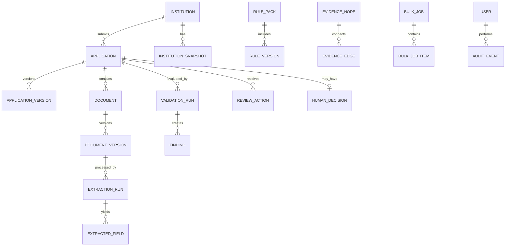

# Domain Model and Canonical Vocabulary

The canonical definitions are below. Extend these definitions; do not create synonyms/status variants casually.

## Main relationships

## Entities and required attributes

### Institution
`id`, `display_name`, `normalized_name`, optional restricted `institution_identifier`, `institution_type`, address/contact fields, active status, created/updated timestamps. Mask sensitive values in list APIs and logs.

### InstitutionSnapshot / Digital Twin Attribute
`id`, `institution_id`, `academic_year`, `effective_at`, `attribute_key`, `value_json`, `source_kind`, `source_id`, `review_status`, `last_verified_at`, confidence, creator/timestamp, optional supersession link.
- Source kind: `APPLICANT_DECLARED`, `AI_EXTRACTED`, `REVIEWER_CONFIRMED`, `AUTHORIZED_EXTERNAL`, `SYNTHETIC_FIXTURE`.
- Review state: `UNREVIEWED`, `CONFIRMED`, `DISPUTED`, `STALE`, `EXPIRED`.

### Application / ApplicationVersion
Application: `id`, `institution_id`, type/category/year, optional external reference, processing status, reviewer assignment, created/submitted/updated times, deadline and current rule-pack version. Processing lifecycle: `DRAFT`, `SUBMITTED`, `QUEUED`, `PROCESSING`, `READY_FOR_REVIEW`, `UNDER_REVIEW`, `CLARIFICATION_REQUESTED`, `RESUBMITTED`, `DECISION_RECORDED`, `CLOSED`, `PROCESSING_FAILED`, `CANCELLED`. Keep official decision separate.

ApplicationVersion is an immutable snapshot of declared fields for each submission/resubmission, with version number, author/time, payload and content hash.

### Document / DocumentVersion
Logical document: `id`, `application_id`, `document_type`, current version and status. Version: `id`, document ID, version number, original filename metadata, opaque storage key, detected MIME, size, server-computed SHA-256, uploader/time, source language, state and superseded version. Version statuses: `UPLOADED`, `QUARANTINED`, `QUEUED`, `PROCESSING`, `EXTRACTED`, `NEEDS_REVIEW`, `FAILED`, `REJECTED_FILE`, `ARCHIVED`.

### ExtractionRun / ExtractedField
Run: document-version ID, pipeline/provider/version, language, timestamps, status and safe error code. Field: `field_key`, raw value, normalized value, confidence `[0,1]` or null, 1-based page number when known, optional bounding box, restricted source excerpt, and optional reviewed value/reviewer/time. Corrections never overwrite raw model output.

### RulePack / RuleVersion
Pack: key, category, academic year, label/status, effective dates, source-set hash, created/published metadata. Rule version: key, pack ID, version number, severity, declarative condition, evidence requirements, source citation, explanation template, status and test results. Published versions are immutable.

### ValidationRun
Application/version, rule pack, engine version, input snapshot hash, status, timestamps, trigger and creator. Trigger is one of `SUBMISSION`, `MANUAL_RECHECK`, `RULE_REPLAY`, `DOCUMENT_REPROCESSING`, `BULK_JOB`.

### Finding
`id`, validation run/application, stable finding key/category, result/status/severity, title, what observed, why it matters, uncertainty note, next step, rule-version ID, creation time and resolution pointer.
- Check result: `PASS`, `REVIEW`, `INSUFFICIENT_EVIDENCE`, `NOT_APPLICABLE`, `ERROR`.
- Finding workflow: `OPEN`, `ACKNOWLEDGED`, `UNDER_REVIEW`, `RESOLVED`, `DISMISSED`, `ESCALATED`, `SUPERSEDED`.
- Severity: `INFO`, `LOW`, `MEDIUM`, `HIGH`; never present as a fraud score.

### EvidenceNode / EvidenceEdge
Node: ID, scope, node type, source entity ID, label, safe summary, source reference, timestamp. Edge: source/target node, relationship type, optional finding, provenance and timestamp. Every graph traversal is scope-checked.

### SourceVerification
Document/finding reference, connector key, status, minimal source reference, request/response fingerprint, check time, latency, safe message and `simulated` flag. Status semantics live in `docs/INTEGRATION_CONTRACTS.md`.

### ReviewAction / HumanDecision
Review action: application/finding, actor, action, reason, evidence refs, timestamp and optional superseded action. Human decision: application, decision type, reason, authorized human, timestamp, exact rule pack, evidence refs and optional superseded decision. Only an explicit human endpoint can create a decision.

### Notification / BulkJob / AuditEvent
Notifications track recipient, related entity, deadline/expiry, reminder window, dedup key, delivery state and acknowledgment/snooze. Bulk jobs track requester/scope, operation, counts, idempotency, progress and failures. Audit events track actor, action, resource, institution scope, correlation ID, time, result and safe metadata; append-only for normal application roles.

## Normalization

- Preserve raw and normalized values separately.
- Normalize Unicode and whitespace for names, but do not infer identity from text similarity alone.
- Parse dates only with known/explicit formats and keep parse status/source text.
- Normalize identifiers according to field-specific format; don't strip arbitrary characters.
- Compare numeric values with explicit units.
- Address similarity is weak evidence and never a unique identifier alone.

## Database constraints

- Do not globally unique-constrain file SHA-256: legitimate reuse/duplicate detection needs multiple upload records. Index hashes for candidate search and scope results.
- Use unique idempotency keys within scope and unique `(rule_key, version_number)`.
- Enforce uniqueness of external application reference only if issuer/category/year semantics guarantee it.
- Keep foreign keys and historical links; don't cascade-delete audit/rule/validation history.
- Index institution/status, application/created timestamp, year, hash, rule applicability, notification due/status.
